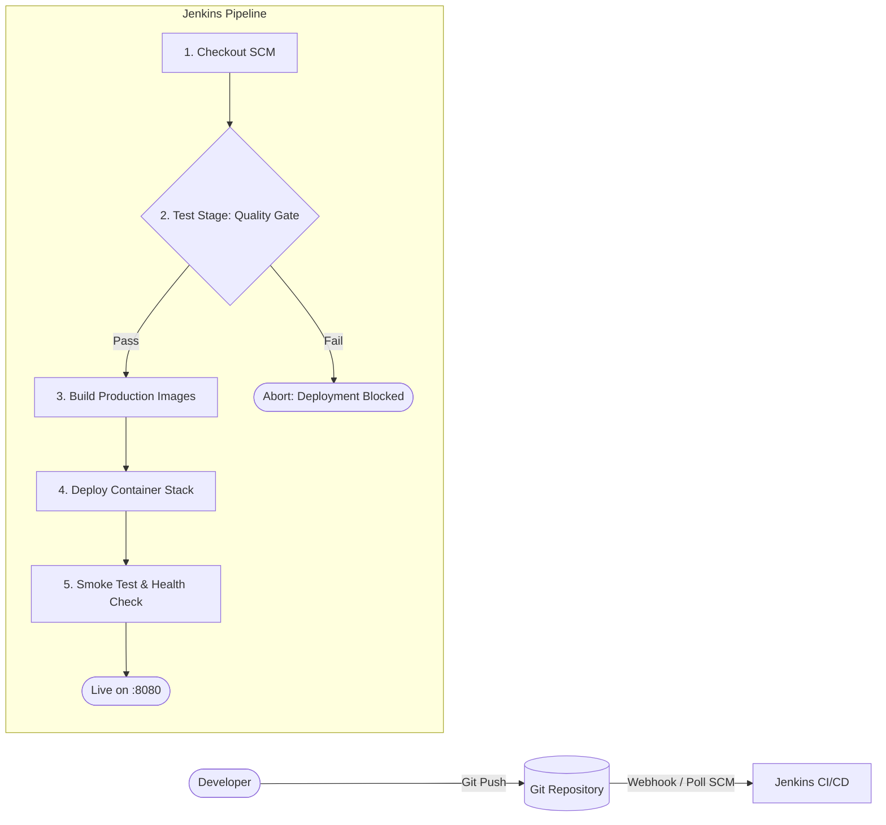

# Circo Technical Architecture & Systems Integration Specification

## 1. System Architecture Overview

Circo is composed of 6 distinct container services working seamlessly across isolated user-defined Docker networks.

### Container Service Matrix

| Service | Container Name | Image Name | Internal Port | External Port | Volumes | Dependencies |
| :--- | :--- | :--- | :--- | :--- | :--- | :--- |
| **Proxy** | `proxy` | `circo/proxy:${TAG}` | `80` | `8080:80` | None | `frontend`, `auth-api`, `resource-api`, `realtime-service` |
| **Frontend** | `frontend` | `circo/frontend:${TAG}` | `80` | None | None | `auth-api`, `resource-api` |
| **Auth API** | `auth-api` | `circo/auth-api:${TAG}` | `4000` | None | None | `db` (healthy) |
| **Resource API** | `resource-api` | `circo/resource-api:${TAG}` | `5000` | None | `upload-data` | `db` (healthy), `realtime-service` (healthy) |
| **Realtime** | `realtime-service` | `circo/realtime-service:${TAG}` | `6000` | None | None | None |
| **Database** | `db` | `circo/db:${TAG}` | `5432` | None | `db-data` | None |

---

## 2. Network Segmentation & Security

- **Network Topology**: All application containers communicate over a private bridge network (`circo-net`).
- **Single Public Ingress**: Only the `proxy` service exposes port `80` (mapped to host port `8080`).
- **Database Isolation**: The PostgreSQL container exposes port `5432` only inside `circo-net`. It is physically unreachable from the host machine or public internet.
- **Non-Root Execution**: Microservice Dockerfiles execute application processes under non-privileged users (`node`), minimizing potential container-escape vulnerabilities.
- **Credential Hygiene**: Passwords and secrets are never committed to source control. They are supplied through `.env` files or injected securely via Jenkins Credentials at deployment time.

---

## 3. Storage & Data Persistence

1. **`db-data` Volume**:
   - Mapped to `/var/lib/postgresql/data` in the `db` container.
   - Retains all tables, relations, indexes, and seeded data across `docker compose down` and container redeployments.
2. **`upload-data` Volume**:
   - Mapped to `/app/uploads` in the `resource-api` container.
   - Retains uploaded binary assets (PDFs, docs, images, archives) independently of the container lifecycle.

---

## 4. CI/CD Lifecycle & Quality Gates

### Quality Gate Enforcement
The test stage runs isolated unit tests inside containerized build environments (`docker build --target test`). If any unit test fails:
- Build exits with code 1.
- Pipeline terminates immediately.
- Deploy stage is completely skipped.
- Production continues serving the previous healthy version with zero downtime.
